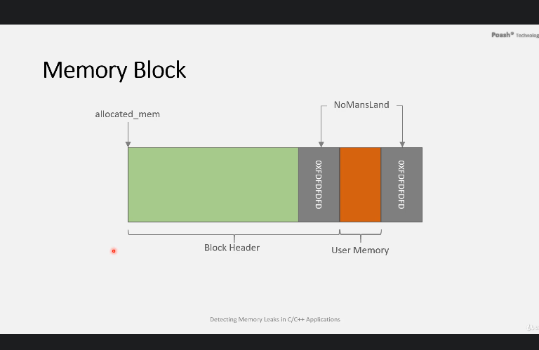

# Udemy Course Debugging C/C++ Memory Issues in Visual Studio
- By Umar Lone

# Section 8: Custom Leak Detector
## 75 Leak Detection Internals
- Debug Heap library is only available in C runtime in Visual Studio in Windows. Cannot use that library on any other compiler, or platform (Mac or Linux).
- Create our own library using C\ C++ features.
- How visual Studio implements the features of leak detection and heap corruption.
    - When user requests memory through malloc or new, heap manager will allocate a memory block larger than size of requested memory.
    - Extra portion of memory block is used to store information about the allocation.
    - Block header
        - line #
        - file name
        - type of block (5 types)
        - function name
        - size of requested memory
        - pointer to prev block (2-way linked list)
        - pointer to next block (2-way linked list)
    - guard bytes (for heap corruption detection)
    - actual memory requested by user
    - leaks are detected if there is memory block in the list. Leaks happen when user forget to free pointer created by new.

## 76 Memory Block Header & ptmalloc() Function
- Our custom leak detection library
- Implementation is in C so that it can be used by both C and C++ program.
- pragma once is platform dependent (not so much. Can use). Pragma once is not standard C++ but it is widely supported (by GCC, Clang, MSVC). It is used to prevent same header from being included multiple times within a single translation unit. If cannot work, use traditional include guards (#ifndef, #define, #endif)
- ptHeader.h: holds the structure of the memory block header
- size_t needs to #include <stddef.h>
- C does not allow function overloading. need to create ptmalloc and ptfree in ptld_c.c.
- if malloc did not succeed, it will return NULL.

## 77 Implementation of ptfree() Function
- user_mem = pCurrentBlock + 1 (dont have guard byte). pCurrentBlock is of type ptMemoryBlockHeader*
- ptIsValidBlock checks if the query block is inside the double linked list

## 78 Implementation of PtDumpLeaks() Function
- check the blocks in the linked list and dump their information
- ptDumpBlock()
- ptmain.h is header file of ptld_c.c. Later to be changed.
- ptmain.h #define malloc and free to use ptmalloc() and ptfree()
- test malloc() and free() and ptDumpLeaks() in main.c

## 79 Adding C++ Support - I
- ptld_cpp.cpp
- operation new and new[], delete and delete[]
- function cannot call c function due to C function name mangling.
- c++ compiler encodes name of all symbols when it compiles the code.
- any c function used in c++ files have to be protected from being mangled => use external c preprocessor directive.
- cannot directly use extern c on these functions because extern c is available only to C++ and not to C.
- Extract C code into ptld_c.h
- protect ptmalloc() and ptfree() functions from being name-mangled in C++ files.
- extern c should be applied only for those headers which are included in c++ files
- check __cplusplus macro is defined to check if header file has been included in a .cpp file.
- user only needs to #include "ptmain.h"

## 80 Adding C++ Support - II
- #define new but no need for delete.
- test use new() and malloc()
- 2 main in VS project. To exclude from build in General > Excluded from build.
- what happens if we compile our code in Release? We dont want overhead of leak checking in release build. => #ifdef _DEBUG to define the macros in ptmain.h.
- need to include <malloc.h> so that code can be compiled successfully in release mode.
- ensure delete is not defined in _DEBUG. Use the standard overloaded operator delete functions from C++ library.

## 81 Compiling on Linux
- gcc does not define _DEBUG (specific to Visual Studio) => gcc -D_DEBUG
- __FUNCSIG__ specific to Visual Studio.
    - #ifdef _WIN32
    - #define PT_FUNCTION_NAME __FUNCSIG__
    - #elif define __GNUC__
    - #define PT_FUNCTION_NAME __PRETTY_FUNCTION__
    - #else
    - #define PT_FUNCTION_NAME "Unknown function"
- gcc -D_DEBUG -c ptld_c.c
- g++ -D_DEBUG main.cpp ptld_cpp.cpp ptld_c.o
- use it on c code, dont need cpp file
- use it on c++ code, need both c and cpp file.
- operator new and delete internally invoke the c functions malloc and free.

# 9 Heap Corruption Support
## 82 Detecting Heap Corruption - Internal Implementation
- How Visual Studio detect heap corruption:
    - user's allocated memory is surrounded with known values (NoMansLand: 0xFDFDFDFD). If values have changed, this indicates memory has been overwritten.
    - user's allocated memory is put in read-only pages. If user attempts to override that memory, the program will crash immediately with access violation.
    - VS implement CRTCheckMemory.
    - Can be heap corruption b4 or aft user block  


## 83 PtCheckMemory() Implementation - I
- unchar char m_Guard[4] implemented in ptHeader.h
- struct ptMemoryBlockHeader now contains the guard cell b4 the user-allocated memory.
- Implemented in ptld_c.c
- #define GUARDFILL: 0xFD
- static variable is only accessible in that .cpp file. If want to share global variable across .cpp file, declare normal variable in .cpp and share using extern in globals.h or other filename.h.
- ptCheckMemory() implemented in ptmain.h and ptld_c.c

## 84 PtCheckMemory() Implementation - II
- ptDumpHeapCorruptionInfo()
- ptGetBegGuard()
- ptGetEndGuard()
- memcmp !=0 => memory not equal

## 85 Alignment & Structure Padding
- Check architecture x64 missing heap corruption detection
    - due to how structure are compiled by c\c++ compiler
    - cpu access memory in multiple of 4 (32-bit processor) or 8 (64-bit processor), depending on word size of processor.
    - word size represent the #bits processed by processor in one go at a time.
    - when cpu access data, the data should be aligned on a word boundary (memory address divisible by 4 or 8).
    - if data is not aligned on a word boundary, cpu has to execute extra instruction to access that data. Degrade performance of application.
    - x86 processor is forgiving when it has to access misaligned data.
    - other processor may throw an exception and program may crash
    - important for programmer to ensure data is aligned. Most of time, compiler takes care of it. This is not the cause of the missing heap corruption detection
- 3 heap corruptions
    ### 1. Out-of-bounds write before an allocated integer
    ```cpp
    int *p1 = new int{5};
    p1[-1] = 3
    ```
    ### 2. Heap buffer overflow
    ```cpp
    char *p = (char*)malloc(5);
    strcpy(p,"Hello");
    ```
    ### 3. Out-of-bounds write before an allocated buffer
    ```cpp
    p[-1]='a';
    ```

## 86 Aligning Memory Block Header
- ptMemoryBlockHeader in x86 is 28B
- ptMemoryBlockHeader in x64 is 56B instead of 48B
    - due to member of structure smaller than word size of processor (8B)
    - compiler allocates padding after m_LineNumber, else variable after m_LineNumber will be misaligned.
- missing heap corruption detection before user block due to padding after the guard bytes
- Not recommended to suppress the paddding generated by compiler
- recommended to store smallest elements inside the structure towards the end so that compiler dont pad structure in the middle. Move int m_LineNumber to the 2nd last element of struct.
- after this change, ptMemoryBlockHeader in x64 is 48B